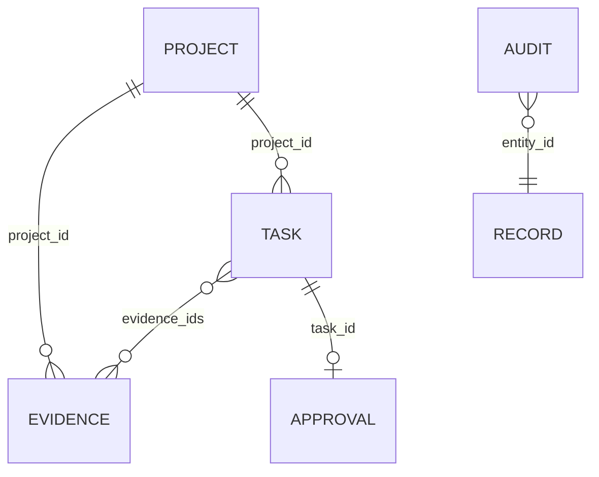

# Datenarchitektur / Schema v1

SQLite hat `records(seq INTEGER PRIMARY KEY AUTOINCREMENT, id TEXT UNIQUE, kind TEXT, body TEXT)` und `control(id PRIMARY KEY CHECK(id=1), active, reason)`. `body` enthält JSON entsprechend den [Pydantic-Modellen](../../app/models.py); Index `(kind, seq)` für Listen. Beziehungen werden bei API-Schreibvorgängen in derselben Transaktion validiert, nicht über relationale Foreign Keys. Direkte SQL-Schreibzugriffe sind nicht unterstützt.

Dies ist ein **logisches** ERD, keine Behauptung separater SQL-Tabellen. `AUDIT.entity_id` ist eine fachliche Referenz, beim globalen Stop der Wert `global`.

| Entity | Felder / Regeln |
|---|---|
| Project | UUID, UTC created_at, name 1..120, description <=2000 |
| Evidence | Projekt, Claim, HTTP(S)-URL, aware observed_at nicht zukünftig, Provider, Source Type, Methode, Originaltext <=20000, SHA-256, Confidence 0..1, Reviewzustand/-grund |
| Task | Projekt, Titel, Action enum, <=50 eindeutige Evidence-IDs desselben Projekts, bestätigte Preconditions, Erstellrolle/-zeit; unveränderlich |
| Approval | UUID, Task-ID, Rolle reviewer, Zeit, Pflichtgrund; maximal eines über transaktionelle API-Prüfung |
| Audit | UUID, UTC, Rolle, Event, Entity-ID, Details JSON |
| Control | ein persistenter globaler Stop und Grund |

## Zustände / Speicherung
Evidence: unverified → verified ODER rejected, terminal. Korrektur nur als neuer Datensatz; keine Supersession-/Revocation-Verknüpfung. Tasks sind unveränderlich. Entscheidungen werden neu berechnet und im Audit gespeichert; keine gespeicherte Task-State-Maschine. Approval bleibt historisch bestehen. Ab v0.3 benötigt jede Verwendung die aktuelle Result-/Challenge-/Fingerprintbindung; Stopereignisse entwerten sie auch nach Reset.

Keine Assets, Devices, Measurements, Agents, Permissions-Tabellen, Actions-Ausführung, Tests-Entities, Repairs oder Trends vorhanden. Ab v0.2 ergänzen Archive-/Cacheblobs und Memory/FTS den Kern; siehe [Context-/Storage-Datenmodell](../20-context-storage/architecture.md). Testreports sind lokale/CI-Dateien, kein Plattform-Datenmodell. Originaltexte unverschlüsselt auf Disk; Rechte, Verschlüsselung und Retention sind Betreiberverantwortung. Keine Delete-API oder DSGVO-Löschworkflow.

## Additive Records 0.4.0.dev
`stop_state`: unveränderliche Provenienz je Stop-Wechsel (`active`, `reason`, aufsteigende `revision`, `actor`, `created_at`, Record-ID), geschrieben in derselben Transaktion wie die `control`-Tabelle. `GET`/`POST /api/control/stop` liefern diesen Zustand. Die `control`-Tabelle bleibt maßgeblich für `stopped()` und damit für Triage, PLAN und Challenge. Existiert kein zum aktuellen Control-Zustand passender Record — Legacy-Bestand oder eine Änderung außerhalb der API — bleiben `revision` 0 und `actor`/`created_at`/`record_id` null; es werden keine Werte erfunden. Die Recordfolge ist keine manipulationssichere Kette: ein DB-Administrator kann sie ändern. Der PLAN-Status kann zusätzlich den defensiven Zustand `BLOCKED`/`NO_PLAN_VERSION_RECORDED` liefern, falls eine PLAN-Identität ohne gespeicherte Version existiert.

## Additive Records v0.3
`result`: unveränderliches Primärpaket mit Claims/Alternativen/Unknowns/Falsifikationsvorschlag. `challenge_job`: Snapshot, Fingerprint, pending/running/completed/superseded, 60s Leasehash/-ablauf. `challenge_report`: immutable policygebundene Findings und Gegenkandidaten, Report-ID. Approval enthält result_id/challenge_id/fingerprint. Adopted Memory enthält decision_result_id/decision_challenge_id/decision_fingerprint, nicht automatisch den ungeprüften Primärtext. Evidence optional observations; ursprünglicher Content-SHA bleibt. Keine vorhandenen Records werden gelöscht. [Schema-/Zustandsdetails](../02-core/challenge-worker.md).
