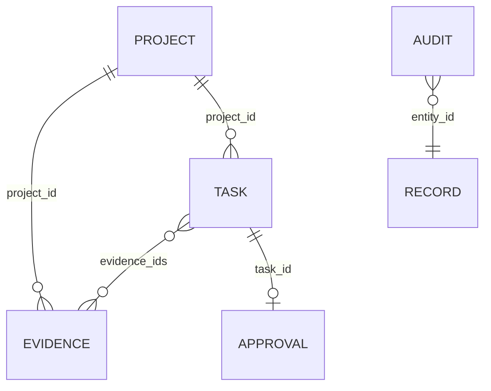

# Datenarchitektur / Schema v1

SQLite hat `records(seq INTEGER PRIMARY KEY AUTOINCREMENT, id TEXT UNIQUE, kind TEXT, body TEXT)` und `control(id PRIMARY KEY CHECK(id=1), active, reason)`. `body` enthält JSON entsprechend den [Pydantic-Modellen](../../app/models.py); Index `(kind, seq)` für Listen. Beziehungen werden bei API-Schreibvorgängen in derselben Transaktion validiert, nicht über relationale Foreign Keys. Direkte SQL-Schreibzugriffe sind nicht unterstützt.

Dies ist ein **logisches** ERD, keine Behauptung separater SQL-Tabellen. `AUDIT.entity_id` ist eine fachliche Referenz, beim globalen Stop der Wert `global`.

| Entity | Felder / Regeln |
|---|---|
| Project | UUID, UTC created_at, name 1..120, description <=2000 |
| Evidence | Projekt, Claim, HTTP(S)-URL, aware observed_at nicht zukünftig, Provider, Source Type, Methode, Originaltext <=20000, SHA-256, Confidence 0..1, Reviewzustand/-grund |
| Task | Projekt, Titel, Action enum, <=50 eindeutige Evidence-IDs desselben Projekts, bestätigte Preconditions, Erstellrolle/-zeit; unveränderlich |
| Approval | UUID, Task-ID, Rolle reviewer, Zeit, Pflichtgrund; maximal eines über transaktionelle API-Prüfung |
| Audit | UUID, UTC, Rolle, Event, Entity-ID, Details JSON |
| Control | ein persistenter globaler Stop und Grund |

## Zustände / Speicherung
Evidence: unverified → verified ODER rejected, terminal. Korrektur nur als neuer Datensatz; keine Supersession-/Revocation-Verknüpfung. Tasks sind unveränderlich. Entscheidungen werden neu berechnet und im Audit gespeichert; keine gespeicherte Task-State-Maschine. Approval bleibt bestehen, Stop kann seine Verwendung temporär blockieren.

Keine Assets, Devices, Files, Measurements, Agents, Permissions-Tabellen, Actions-Ausführung, Tests-Entities, Repairs, Trends oder Runtime-Artefakte vorhanden. Testreports sind lokale/CI-Dateien, kein Plattform-Datenmodell. Originaltexte unverschlüsselt auf Disk; Rechte, Verschlüsselung und Retention sind Betreiberverantwortung. Keine Delete-API oder DSGVO-Löschworkflow.
