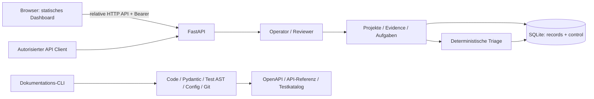

# System- und Komponentenarchitektur



## Komponenten / Dependencies
`config.py`: fail-closed Secrets und DB-Pfad. `models.py`: Pydantic-Feldverträge. `store.py`: lokale SQLite-Verbindungen und Transaktionen. `triage.py`: reine Policyfunktion ohne I/O. `main.py`: HTTP, Rollen, Referenzvalidierung, Audit. `static/`: Oberfläche ohne Framework oder Build. `scripts/docs.py`: Entwicklungswerkzeug, kein autonomer Produktionsworker.

## Aktuelle Sequenz
```mermaid
sequenceDiagram
    participant O as Operator
    participant A as API
    participant R as Reviewer
    participant D as SQLite
    O->>A: Projekt und Evidence erfassen
    A->>D: unverified + Hash + Audit (atomar)
    R->>A: Review mit Grund
    A->>D: verified/rejected + Audit
    O->>A: unveränderliche Aufgabe mit Evidence-IDs
    A->>D: Aufgabe + Audit
    O->>A: POST triage
    A->>D: Evidence / Stop / Approval lesen
    A->>D: Entscheidung im Audit
    A-->>O: blocked / eligible / approval_required
    R->>A: POST approve mit Grund
    A->>D: Triage erneut prüfen; Approval + Audit
    A-->>R: Freigabedatensatz, KEINE Ausführung
```

## Ereignisse und Deployment
Audit ist ein persistentes Ereignisregister, kein Eventbus. Keine WebSockets, MQTT, Queue oder Subscription. Ein Prozess, ein lokales Dateisystem, kein verteilter Lock. SQLite `BEGIN IMMEDIATE` serialisiert auch API-Lesetransaktionen; sinnvoll für den kleinen Kern, begrenzt Durchsatz. Schema- und Konfigurationsdetails: [Daten](data-architecture.md), [Konfiguration](../19-operations/configuration.md).

## Erweiterung v0.2
Das Diagramm oben beschreibt den fortbestehenden Evidence-/Approval-Kern. Die aktive Erweiterung liegt in `context_models.py`, `context.py`, `context_api.py` und `storage.py`: externe immutable Textarchive, taskgebundene Cacheblobs, append-only Memory und lokale FTS-Suche. [Aktuelles erweitertes Systemdiagramm](../20-context-storage/architecture.md), [Copy/Verify/Index-Sequenz](../20-context-storage/contracts.md). Es gibt weiterhin keinen Eventbus/MCP-Transport/Orchestrator oder ausführenden Agenten.

## Erweiterung v0.3
Ein realer separater Challenge-Prozess ergänzt die API: Result → serverseitiger Snapshot/Job → workergebundener Lease → fünf deterministische Checks → verifizierter Report → aktuelle Triage → Human Approval/Adoption. [Tatsächliches Sequenzdiagramm und Grenzen](../02-core/challenge-worker.md). Dies ist keine zusätzliche Promptrolle desselben Primary; API-Rechte und Prozess sind getrennt. Gegenprüfung nutzt nur vorhandene eingereichte Evidence, keine unimplementierten Suchprovider. Worker und API teilen Regelcode; keine organisatorische Quellen-/OS-Isolation behauptet.

## Modellpfad 0.4.0.dev0 (kein autonomer Agent)
Operator → ausgewählter Kontext → konservative Klassifizierung/Secretblock → exakt geprüfte Reviewer-Consent → aktuelle Policy/Stop → ExternalDataGateway → konfigurierter Textendpoint → untrusted Draft. Relevante Schlussfolgerung bleibt anschließend Result/Challenge/Triage-pflichtig. Kein Modell erhält DB-/FS-/Terminal-/Toolobjekte. Kein Modelldownload beim Serverstart. [ADR-005](../adr/ADR-005-private-model-gateway.md).
