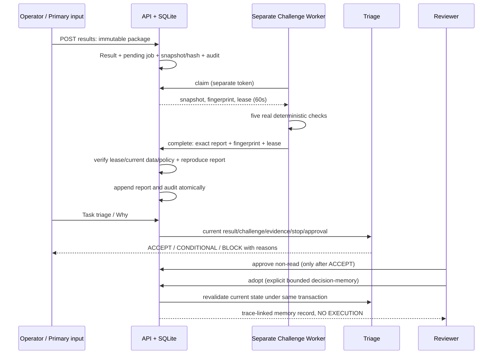

# Challenge Worker / Adversarial Validation — v0.3

**Every Decision Must Survive Challenge.** [ADR-004](../adr/ADR-004-challenge-before-decision.md) ersetzt die bisherige direkte Task→Approval-/Fact-Memory-Annahme. Die [No-Fake-Policy](../../REALITY_POLICY.md) gilt unverändert.

## Tatsächlicher Umfang / Unabhängigkeit
Ein realer separater Python-Prozess liest Jobs über HTTP, prüft einen serverseitigen Snapshot und liefert einen echten deterministischen Gegenprüfungsreport. Eigener Worker-Token, keine Operator-/Reviewer-Rechte und keine benötigten DB-Credentials. Kein Primary-LLM mit anderem Prompt, kein Client-setzbarer PASS, keine synchron eingesetzte Ersatzprüfung bei Worker-Ausfall.

**Grenze:** Primary ist derzeit eine manuelle Operator-Ergebniseinreichung, kein implementierter Agent Builder. Worker und Server verwenden denselben versionierten Regelcode; organisatorische Unabhängigkeit, getrennte Modelle und unabhängige Online-Suchprovider sind nicht implementiert. Der Worker untersucht alle vorhandenen Projekt-Evidenzen, nicht nur die vom Primary verknüpften Belege. Keine neuen Webquellen, Geräte oder Messungen werden erzeugt. Getrennte Prozesse auf demselben Entwicklungsnutzer sind KEINE OS-/Sandbox-Isolation; für Produktion getrennte Accounts/Secrets/Deploymentgrenzen etablieren.

## Ablauf

`CONDITIONAL` ist kein „trotzdem weiter“: Task-state bleibt blocked, keine Approval-/Adopt-Freigabe. Pending/fehlend/stale/worker unavailable → BLOCK. ACCEPT gilt ausschließlich für den im Report genannten Scope `submitted_structured_claims_only`.

## Result Package — Inputs / Outputs
`POST /api/results`, Operator, 201 bedeutet **erfasst**, nicht akzeptiert. Inputs:
- existierende Task-ID; kind research/calculation/plan/action/presentation;
- summary und primary_worker als unvalidierte eingereichte Angaben;
- 1..20 strukturierte Claims: subject, variant, revision, attribute, value, unit, conditions, Evidence-IDs, requires_measurement (Default true), causal (Default false);
- bis zu 10 dokumentierte Alternativen (subject, rationale, Evidence-IDs), bis zu 20 UNKNOWN-Texte, Pflichtvorschlag falsification_test.

Alle Referenzen müssen real existierende Records desselben Projekts sein, keine Duplikate je Claim/Alternative. Operator kann nicht id, verdict, created_by oder Report setzen. Result/Task unveränderlich; Korrektur als neues Result Package. Alte Ergebnisse bleiben erhalten, neuestes Ergebnis ersetzt ihre Entscheidungsfähigkeit.

**Freitextgrenze:** summary, rationale und primary_worker werden nicht semantisch bewiesen. Auch ein PASS für einen Spannungswert bestätigt keine umfassende „Motor geeignet“-Zusammenfassung. Adopt kopiert deshalb NICHT die Primärzusammenfassung als Fakt, sondern speichert einen bounded Decision-Snapshot-Verweis auf die geprüften strukturierten Claims, Challenge und Fingerprint.

## Strukturierte Evidence
Evidence erhält optional `observations` (max. 50): subject/variant/revision/attribute/value/unit/conditions und basis=manufacturer/measurement/manual. Vorhandener content/SHA-256 und manuelles terminales Evidence-Review bleiben bestehen. Strukturierte Felder sind eingereichte Metadaten; keine automatische Extraktion aus PDF/Web oder unabhängige Prüfung realer Identität.

Für Messungsunterstützung braucht ein Claim matching Observation basis=measurement **und** Evidence source_type=measurement sowie verified Review. Ein Herstellerdatenblatt zählt nicht als reale Messung. Die Typ-/Reviewdeklaration ist kein Hardware-Livetest. Testinputs sind weiterhin ausdrücklich synthetisch und in getrennten test-Instanzen.

## Fünf tatsächliche Prüfarten
| Prüfung | Real implementierte Regel | Ergebnis bei Lücke / Grenze |
|---|---|---|
| Evidence | Existenz, Content-SHA, Reviewstatus, gemeldete Confidence >=0.8; genaue strukturierte Unterstützung und deklarierte Messungsbasis | fehlend/Hash/rejected BLOCK; unreviewed/fehlende passende Identität/Messung CONDITIONAL |
| Consistency | untersucht alle eingereichten Projekt-Evidence auf identisches subject/variant/revision/attribute/unit/conditions und abweichenden Wert | Widerspruch BLOCK, keine Wahl des „schönsten“ Werts; abweichende Einheiten/Bedingungen verknüpfter Quellen CONDITIONAL |
| Alternative | findet andere belegte subjects mit passender Eigenschaft/Einheit/Bedingung/Wert; prüft deklarierte Alternativen gegen verified Identitätsbeleg | kein Kandidat → CONDITIONAL, keine erfundene Alternative; Kandidaten sind nur für diese Eigenschaft vergleichbar, keine Gesamtempfehlung |
| Causality | deklarierter causal-Claim wird erkannt; kein kontrolliertes Experimentmodell vorhanden | CONDITIONAL statt erfundenem Kausalitätsnachweis; Freitextkausalität nicht automatisch erkannt |
| Action | Preconditions, vorhandene Ausführbarkeit, High-impact-Grenzen | fehlende Preconditions BLOCK; kind=action BLOCK (kein Executor); Flash/Firmware/EDL/Prod/Payment CONDITIONAL mangels unabhängiger Live-/Permissionprüfung |

Explizite UNKNOWN-/NaN/Inf-/?-Sentinels in Pflichtparametern zählen nicht als geprüfte Werte. Unbekannter Falsifikationstest und eingereichte unknowns ergeben CONDITIONAL. `kind=calculation` bleibt CONDITIONAL: es gibt keine allgemeine Rechenparser-/Recompute-Engine. Falsifikationstest ist ein **Vorschlag**, kein ausgeführter Test.

Wertvergleich: bei zwei endlichen Decimal-Werten numerische Gleichheit, sonst case-insensitiver Stringvergleich. Keine Einheitenumrechnung, Intervallarithmetik, Toleranz-/Messunsicherheitsrechnung oder Modellrevision-Inferenz. `12–18` wird nicht still als gleich `18` behandelt. Widersprüche sind Hinweise auf eingereichte Daten, keine erfundenen externen Gegenbeweise.

## Bounded Scope / Stop-the-Line
Maximal 500 Projekt-Evidenzen und 4 MiB serialisierte Evidence-Daten je Snapshot. Überschreitung → BLOCK ohne Teil-PASS; Snapshot enthält Größen-/Countnachweis und expliziten Truncationstatus. Maximal 500 Findings plus ein kritischer Limitbefund; ausgelassene Findings erzwingen BLOCK. Maximal 50 belegte Gegenkandidaten im Report. Keine Behauptung vollständiger Recherche außerhalb dieses lokalen Umfangs. Keine 2-GB-Lastgarantie.

## Fingerprint / Staleness / Leases
SHA-256 über kanonisches JSON von Task, Result, gesamtem berücksichtigtem Projekt-Evidencezustand, Policyversion und letztem Stop-Auditereignis. Eine neue/geänderte Evidence, ein neuer Result, ein neuer Challenge-Job oder ein Stop/Reset entwertet vorherige Passes/Approvals. Allein den Stop zu deaktivieren stellt eine alte Freigabe NICHT wieder her.

Job: pending → running (60s Lease) → completed; veraltete Jobs → superseded. Abgelaufene Leases können erneut geclaimt werden; alter Lease/Replay wird abgelehnt. Worker-Ausfall bleibt pending/running-expired, kein automatischer grüner Ersatzreport. Poll scannt bis 100 Jobs pro Request; obsolete Jobs werden auditiert superseded, Folgescan behandelt weitere Jobs.

Completion akzeptiert nur separaten Worker-Token, richtigen aktuellen Lease, identischen Snapshotfingerprint, neuestes Ergebnis/neuesten Job und exakt reproduzierbaren Report nach aktueller Policy. Gefälschte/abgeänderte Verdicts → 422; stale/lease/replay/stop → 409. Das serverseitige Nachrechnen **verifiziert den eingereichten Workerreport**; es erzeugt keinen Report ohne echten Workeraufruf.

## Triage / Approval / Memory
Task-triage verwendet das obligatorische Challenge-Gate zusätzlich zu bisherigen Evidence-/Confidence-/Precondition-/Stopregeln. Response enthält validation_status, result_id, challenge_id, fingerprint, challenge_reasons; executed bleibt false.

Nach ACCEPT: READ kann eligible werden; WRITE benötigt weiterhin Reviewer-Approval. Approval bindet Result + Challenge + Fingerprint. Hochrisikoaktionen werden durch die aktuelle Challenge nicht freigegeben. Adopt benötigt Reviewer-Grund und aktuellen Triagezustand eligible/approved; doppelte Adoption desselben Challenge-Reports → 409. Audit/Memory/FTS sind atomar. Primärfreitext wird nicht übernommen.

Direktes neues `POST /api/memory` mit category fact oder decision → 409. Manuelle inference/preferences/history bleiben recorded/untrusted, nie automatisch akzeptierte Entscheidungen. Historische Fact-/Decision-Memory bleibt erhalten, besitzt aber keinen aktuellen Challenge-Pass. RAG liefert Decision-Provenance und berechnet decision_status erneut; veraltete/Legacy-Decision → BLOCK, allowed_for_action bleibt immer false. Eine Memorykopie ist keine dauerhafte Ausführungserlaubnis.

## Schnittstellen / Permissions / Examples
Alle Details/Constraints: [generierte API-Referenz](../08-network/APIs.md), [OpenAPI](../../openapi.yaml).

| Route | Rolle | Zweck / Side Effect |
|---|---|---|
| POST /api/results | operator | unveränderliches Package + initialer Job + Audit |
| GET /api/results | beide Benutzerrollen | Primärpakete lesen, nicht als akzeptiert behandeln |
| POST /api/results/{id}/challenge | beide Benutzerrollen | echten neuen Job mit Grund anfordern; alten Pass entwerten |
| GET /api/results/{id}/why | beide Benutzerrollen | aktuelle Triage, letzter Job/Report, current-Flag, Befunde |
| POST /api/results/{id}/adopt | reviewer | nach erneuter Gateprüfung bounded Decision-Memory speichern |
| POST /api/challenge/jobs/claim | nur challenge-worker | Job lease; null wenn kein zulässiger Job |
| POST /api/challenge/jobs/{id}/complete | nur challenge-worker | Reportprüfung + persistenter Abschluss/Audit |
| GET /api/evidence/{id} | beide Benutzerrollen | tatsächlich erfasste Originalquelle samt Metadaten |

Worker kann mit seinem Token keine allgemeinen Projekte/Evidence/Tasks schreiben oder Reviewer spielen. Operator/Reviewer können nicht selbst Worker-Reports abschließen. Standardrollen sind trotzdem geteilte Service-/Benutzertokens, keine individuellen Personenidentitäten.

Ausführbarer **synthetischer Testfall über echte getrennte Prozesse**: `python scripts/smoke.py --allow-fixtures`. Eigene temporäre Instanz und Credentials, keine Betriebsdaten. Zwei echte Worker-Prozessaufrufe, Status-/Reportprüfungen, Reviewer-Adoption und anschließende Invalidierung. Das ist kein Motor-/Provider-/Hardwaretest.

## Installation / Betrieb / Recovery
1. Dritten unterschiedlichen zufälligen Token für `ATZE_CHALLENGE_TOKEN` erzeugen; API und Worker erhalten denselben Servicetoken, Worker keine Operator-/Reviewer-Secrets.
2. API wie bisher starten; Worker separat: `python -m app.challenge_worker --url http://127.0.0.1:8000` (oder HTTPS-Origin remote). `--once` bearbeitet maximal einen Job und beendet sich.
3. Client erfasst tatsächliche Evidence, Review, Task und Result. Keine Seed-Daten in der Vorschau.
4. Fehlender Token → NOT CONFIGURED. `/api/runtime` bestätigt nur Konfiguration, keine Liveness. Fehlende Jobs/ausgefallener Worker sind nicht PASS.
5. Lease läuft nach Prozessabbruch ab; Worker neu starten, bei stale Snapshot explizit neue Challenge anfordern. Keine SQL-Manipulation oder Deadline-Bypässe.

Worker benutzt urllib, 20s HTTP-Timeouts, 2s Pollintervall, keine Proxyübernahme und keine Redirectweiterleitung des Servicetokens. HTTP nur Loopback; remote HTTPS. Er kann auf dem Entwicklungs-Host trotzdem denselben OS-Nutzer haben; tatsächliche Hostisolation ist nicht implementiert. Keine zusätzliche externe Abhängigkeit/LLM nötig. SQLite/Datei-/Modus-Backupgrenzen aus v0.2.1 bleiben bestehen.

## UI / Presentation
„Warum?“ lädt einen aktuellen Entscheidungssnapshot; „Herausfordern“ fordert mit konkretem Grund einen neuen Job an und entwertet alte Freigaben; „Quellen“ liest echte Evidence-Records (erste 30 Referenzen, weitere via API). Kein statischer Challenge-Dummy. Ohne Result leerer Zustand, ohne Report NOT RUN/pending, veraltete Reports als historisch/nicht freigabefähig. ACCEPT ist nicht gleich „Motor geeignet“ und keine Execution. Primärtexte werden ausdrücklich als nicht semantisch validiert gezeigt.

## Tests / Failure Modes / Known Limitations
CH-001..017 und angepasste bisherige Regressionsfälle: Pflichtgate, Rollen, gefälschter PASS, Lease/Replay, neue Evidenz/Result/Challenge, Stop/Reset, Varianten/Einheiten/Bedingungen, unbekannte Messungen, alternative Quellen, Kausalität, Scopegrenzen, Adoption/Audit/RAG-Staleness. Tatsächliche Ergebnisse im [Validierungsbericht](../../FINAL_VALIDATION_REPORT.md).

Keine unabhängige Webrecherche, Source-Organisation-Validierung, automatische Relevanz-/Semantikerkennung, freie Mathematik, kontrollierte Kausalexperimentprüfung, reale Geräteidentität oder allgemeine Tool-Execution. Human-reviewed Quellen können falsch sein. Unterschiedliche URLs sind kein Unabhängigkeitsbeweis; wichtige Liveentscheidungen bleiben deshalb eingeschränkt. Keine vollständig automatisierte Browser-E2E-/Produktions-/Multi-Host-/Last-/OS-Isolationsabnahme.
