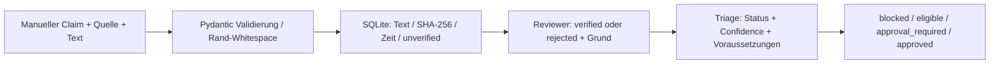

# Evidence / Provenance

## Purpose
Claims mit konkretem eingereichten Originaltext und Herkunft speichern; erlaubte Nutzung über menschliches Review und konservative Triage begrenzen.

## Inputs / Outputs
Inputs: project_id, claim, source_url (HTTP/S), observed_at mit Zeitzone und nicht zukünftig, source_type (manual/document/measurement), provider, extraction_method, content, confidence 0..1. Outputs: diese Felder plus UUID, serverseitige UTC-Erfassungszeit, SHA-256 des gespeicherten UTF-8-Texts, initial unverified, später Reviewgrund und verified/rejected.

Pydantic entfernt Rand-Whitespace von Stringfeldern. Der Hash bindet den **gespeicherten normalisierten Text**, nicht notwendigerweise die Originalbytes eines Downloads. Kein Download findet statt. Keine Datei-Version, Binäroriginalreferenz, Signatur oder unabhängiger Zeitnachweis vorhanden.

## Dependencies / Configuration / Permissions
FastAPI/Pydantic und SQLite, [Konfiguration](../19-operations/configuration.md). Operator erfasst; Reviewer prüft genau einmal; beide lesen. URL, Provider, Extraktionsmethode und Confidence sind erfasste Angaben, keine vom Server bestätigte externe Herkunft. observed_at ist behauptete Beobachtungszeit, created_at ist Erfassungszeit.

## Failure Modes / Validation / Tests
Unbekanntes Projekt 404; falsche URL/Zeit/Länge/Confidence 422; wiederholtes Review 409; falsche Rolle 403. EVD-001 vergleicht den echten SHA-256 und Reviewtransitionen; EVD-002 prüft invalide Metadaten. [Testkatalog](../14-testing/test-catalog.md).

## Security / Examples / Known Limitations
[API-Smoke](../../scripts/smoke.py) verwendet explizit synthetische Fixtures. URLs werden nicht abgerufen und sind kein SSRF-Client. Content darf keine Secrets enthalten; gespeichert wird im Klartext. Review kann falsch sein. verified bedeutet nicht objektiv wahr. Keine automatische Quellenrangfolge, Aktualitätsprüfung, Cross-Source-Validierung, Widerruf, Bright-Data-Verbindung, PDF/Crawl/Browser oder Herkunftssignatur.
