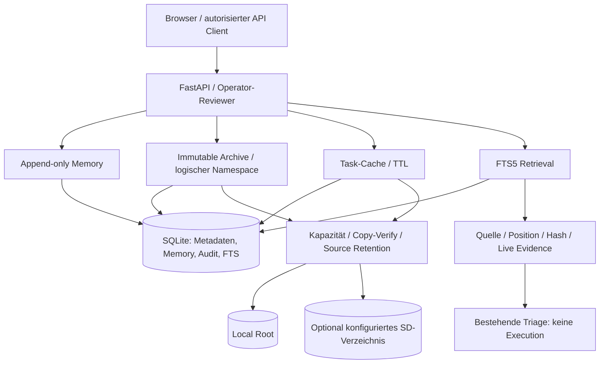

# Mobile Project Server + MCP/RAG Memory Layer

Zentrale Architekturentscheidung: [ADR-003](../adr/ADR-003-mobile-context-storage.md). **v0.2 implementiert einen lokalen Context-/Storage-Kern, keine komplette mobile oder verteilte Plattform.**

## Ziel und tatsächlicher Stand
| Teil | Implementierter Stand | Grenze / nächste Arbeit |
|---|---|---|
| GitHub-Backbone | versionierter Code, Doku, Schemas, Tests, ADRs, CI | kein Runtime-GitHub-Connector, keine automatische Commit→Test→Evidence-Kausalanalyse |
| Mobile Project Server | bestehender Python-Server läuft lokal ohne Cloud | nur Linux-Testumgebung; Android/Termux/Pi/Edge-Hardware nicht validiert |
| MCP | vorgesehene universelle Tool-/Context-Grenze | NOT IMPLEMENTED: kein MCP-Host/-Server, JSON-RPC-Transport, Capability Negotiation oder SDK; REST ist nicht MCP |
| RAG | lokale FTS5-Retrieval-Stufe mit Quellen/Positionen/Hash | keine generative Antwort, Embeddings, PDF/OCR/Bild/CAD-Ingestion, Commits-/Issue-/Log-Importe oder Remote-Föderation |
| Memory | 11 Klassen append-only, Evidence-/Task-/optionale Commit-Referenz | manuelle Behauptungen, keine autonome Erinnerung/Graph-Kausalität |
| Archive | externe unveränderliche UTF-8-Originalblobs + logischer Namespace | maximal 65.536 Unicodezeichen pro Objekt; keine großen Binär-/Build-Artefakte oder Revisionen desselben Pfads |
| Cache | taskgebundene Textblobs, TTL, explizites Cleanup | kein Agent-Workspace-/Tool-Executor, kein Timer/Daemon, keine Prozessisolation |
| Ressourcen | echte Dateisystemkapazität, auto Erstplatzierung Local→SD | kein RAM-Monitor, Access-Frequency-/Cold-Data-Rebalancing oder Worker-Scheduler |
| Tier 0 / 1 / 2 / 3 / 4 | 1 lokal, 2 optionales Betreiberverzeichnis | 0 RAM, 3 Server, 4 Cloud NOT IMPLEMENTED; „SD“ identifiziert keine Hardware |
| Offline | lokale Daten/Index weiter ohne Cloud nutzbar | keine Offline Queue, Sync, Konflikterkennung oder Merge-Protokolle |
| UI | reale Storage Health, Cachebytes, Quellen-Suche | neue Datenpflege/Relocation/Cleanup per API; keine gefälschten Beispielwerte |

## Tatsächliche Architektur

MCP, Remote Storage, Offline-Sync und Orchestrator befinden sich bewusst NICHT im Diagramm der implementierten Laufzeit. Der neue Domain-Service kann später aus einem standardkonformen, authentifizierten MCP-Adapter angesprochen werden. Tools müssen feste Schemas, Rollen, Projekt-/Task-Kontext, Side Effects und Preflight-Gates haben. Kein universelles Terminaltool ohne separate Isolation und ausdrückliche Policy.

## Logisches Datenmodell
Die bestehende `records`-Tabelle erhält neue `kind`-Werte `memory`, `archive`, `cache`. Archive haben einen eindeutigen partiellen SQL-Index auf `logical_path`. `context_fts` ist eine neue FTS5-Tabelle (project_id, source_id, start_char, end_char, text); keine externe Vektordatenbank.

- Memory: Kategorie, Text, Evidence-IDs, optional Task-ID/Commit-SHA, serverseitige Zeit, SHA-256, state=recorded.
- Archive: ID, Projekt, stabiler Pfad, Hash/Bytelänge, UTC, Evidence-IDs, aktiver Tier/Key, retained_copies, version=1.
- Cache: ID, Task/Projekt, Tier/Key, Hash/Bytelänge, UTC/Expiry, active/expired, deleted.
- FTS: abgeleitete Textkopien und Zeichenbereiche; niemals unabhängige Wahrheits- oder Originalquelle.

Physische Dateien heißen ausschließlich `{server_uuid}.blob`. Der logische Pfad `/project/{project_id}/tests/measurement.txt` wird als DB-Schlüssel aufgelöst, niemals als OS-Pfad interpretiert. Umplatzierung ändert nur Tier/Key/Retained Copies; Source-ID, Hash, Version und logischer Pfad bleiben gleich.

## GitHub-Verknüpfung und Aussagen
Memory kann ein existierendes Task desselben Projekts und eine formal gültige 40-stellige Commit-SHA referenzieren. Die Commit-SHA ist eine **eingereichte Angabe**, keine geprüfte GitHub-Existenz oder kausale Aussage. Agent/Test-Verknüpfungen sind nicht als automatische Entitäten implementiert. Private Rohtexte, Memory, Datenbank, Cache und Blobs gehören nicht automatisch nach GitHub. Nur reviewed technische Änderungen/Reports werden versioniert.

„Dieser Fehler existiert seit Commit X“ erfordert reale vergleichbare Vorher-/Nachher-Tests. Eine Retrieval-Korrelation allein trägt keinen Kausalitätsnachweis. Gleiches gilt für die Beispiel-Motordaten: sie werden nicht als echte Beobachtungen übernommen.

## Migration / Backup / Rollback
v0.1→v0.2 ist additiv; Records/Control/Approval/Triage bleiben erhalten. FTS5 muss im SQLite-Build verfügbar sein; Start schlägt andernfalls fehl, kein stiller Fallback. Alte Evidence-Records werden nicht automatisch importiert/indiziert. Nur neue Archive/Memory werden indexiert; Reviewer kann diese paginiert neu indexieren.

**DB-only Backup ist ab v0.2 kein vollständiges Backup.** `scripts/backup.py` bleibt ausdrücklich ein SQLite-Werkzeug und gibt diese Grenze aus. Vor sicherem Gesamtsnapshot alle App-/Maintenanceprozesse stoppen, SQLite per Backup-API sichern, beide Objektwurzeln inklusive retained copies separat vollständig kopieren, Manifest/Hashes/Rechte prüfen. Cache darf ausgelassen werden, dann muss mit verlorenen Cacheinhalten gerechnet werden (503 bzw. 410); er ist nie Originalspeicher. Ein produktionsreifer atomarer Multi-Tier-Snapshot/Restore-Workflow ist noch BLOCKED.

Bei Restore zuerst DB auf neuen Pfad, kopierte Objektwurzeln setzen, Archive über die API hashprüfen; neuen Index erst nach erfolgreicher Originalprüfung wieder aufbauen. Originale/Retention-Kopien nicht löschen. Keine automatische Rückmigration oder Garbage Collection nach Rollback.
